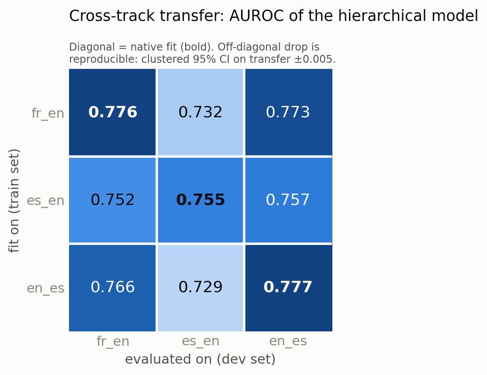
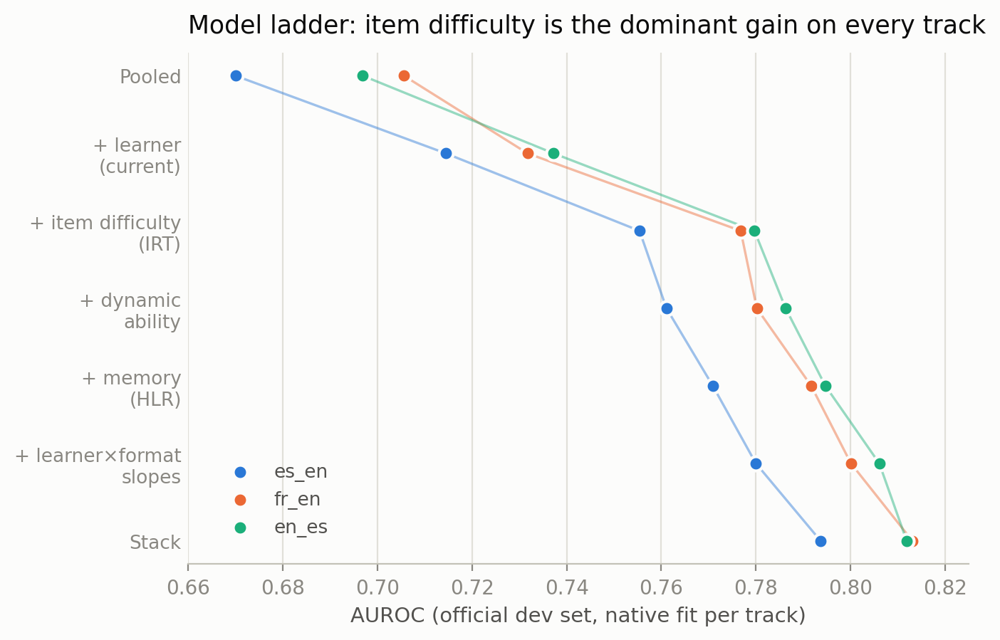
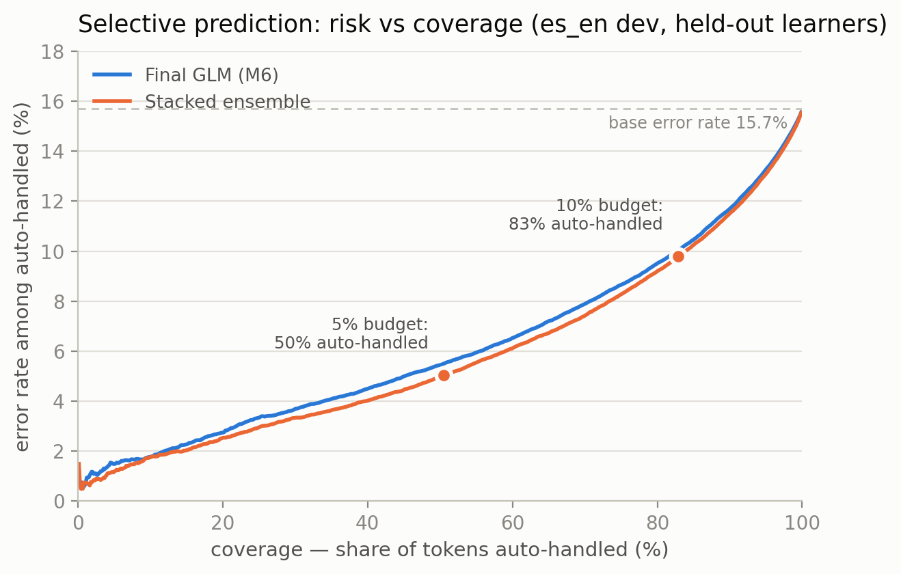

# Uncertainty-Aware Modeling of Second-Language Acquisition

**A tutor that knows when it doesn't know.**

Shane Dunkle · Richard Pollitt
Final project — ADSP 32014: Bayesian Machine Learning with Generative AI Applications,
University of Chicago MS in Applied Data Science (Summer 2026)

We model *when* language learners make errors on Duolingo exercises — and *how
confident the model is* — so an adaptive tutor can defer to a human instead of
guessing. Using the public [Duolingo SLAM 2018 dataset](https://doi.org/10.7910/DVN/8SWHNO)
(5.5M+ exercise tokens, 6,400+ learners, three language courses), we build a
hierarchical Bayesian error model with calibrated uncertainty, test Hidden Markov
acquisition stages against a predefined forward-validation gate, diagnose
cross-course transfer, and wrap the predictions in a routing layer with
distribution-free guarantees.

## Headline results

| Finding | Evidence |
|---|---|
| **Partial pooling earns its structure** | Native AUROC 0.755 / 0.777 / 0.777 (es_en / fr_en / en_es); ELPD +2,158 ± 77 vs pooled; ECE 0.020 → 0.014 |
| **Discrete acquisition stages: honest negative result** | Interpretable unlearned → learning → acquired states, but the HMM hybrid failed forward validation (ungated: NLL +0.00055 [+0.00018, +0.00092], worse in all folds) |
| **Item difficulty (IRT) is the dominant missing signal** | +0.041–0.045 AUROC on every course; passed the same forward-validation gate the HMM failed (+0.036 AUROC, −0.017 NLL, consistent in every out-of-time fold) |
| **Full extension ladder** | + dynamic ability, memory/HLR features, learner×format slopes → 0.780 / 0.800 / 0.806; stacking → 0.79–0.81; the interpretable GLM matches or beats a GBM on identical features |
| **Transfer gaps are concept shift, not covariate shift** | Transfer penalty real (clustered 95% CI [0.727, 0.737] vs native 0.755); reweighting hurts; group-intercept recalibration on ~10% of target learners recovers most native performance |
| **Difficulty geometry follows the language contrast** | Joint-model deviation space: the es_en~en_es mirror pair is closest (cosine −0.18 vs −0.5 chance); the same-L1-population pair is not — the course, not the population, sets the difficulty map |
| **Routing with a guarantee** | Split-conformal abstention: ~50% of tokens auto-handled at a 5% error budget, ~83% at 10%; guarantees held within 0.3pp on held-out learners |





## Repository map

```
analysis/    Standalone analysis scripts (MAP analogues of the Bayesian pipeline)
             parse_slam.py           SLAM format -> parquet
             fit_models.py           shared feature blocks + per-track fits
             ladder_track.py         full model ladder for any track (M1-M7 + stack + conformal)
             bootstrap_analysis.py   learner-clustered bootstrap CIs
             fit_variance.py         fit-side variance via learner-bootstrap refits
             analysis3a_recal.py     recalibration-only transfer (localizes the gap)
             analysis3b_covshift.py  covariate-shift check + importance-weighted refit
             analysis4_joint.py      joint multi-track model + track-similarity readout
             forward_gate.py         out-of-time forward-validation gate
             stack_conformal.py      stacking ensemble + split-conformal abstention
figures/     Publication figures (generated by tools/make_figures.py)
docs/        Written findings, report subsections, presentation deck + scripts
tools/       Generators for the figures and the slide deck
data/        NOT included — see data/README.md for download + citation
```

Scripts expect the SLAM files under `slam/<track>/` (see `data/README.md`) and run
on Python 3.10+ with `pandas`, `pyarrow`, `numpy`, `scipy`, `scikit-learn`,
`matplotlib`. They are MAP (L2-regularized) analogues of the PyMC pipeline: each
model block corresponds to a hierarchical Bayesian prior (item difficulties =
item-level random effects; shrunk slope blocks = stronger priors), chosen so the
full data fits on modest hardware. Methods and caveats are documented in
`docs/model_ladder_comparison.md` and `docs/transfer_gap_deep_dive.md`.

## Data access (not distributed here)

The SLAM 2018 dataset is **© Duolingo, Inc., licensed CC BY-NC 4.0** and is not
redistributed in this repository. Download it from the Harvard Dataverse:
**https://doi.org/10.7910/DVN/8SWHNO** — see `data/README.md` for layout and the
required citation (Settles et al., 2018).

## Method summary

1. **Hierarchical Bayesian logistic model** (learners nested in L1/country groups;
   format, session, POS, morphology, dependency effects), fit with NUTS/ADVI in the
   main pipeline; MAP analogues here for full-data experiments.
2. **HMM acquisition stages** over each learner's 30-day timeline, evaluated
   against a predefined forward-validation confirmation gate (negative result;
   retained as a descriptive model).
3. **Model ladder**: + word-level item difficulty (Bayesian IRT reading), +
   leakage-safe dynamic-ability features, + half-life-regression-style memory
   features, + learner×format random slopes; every rung tested with
   learner-clustered bootstrap CIs and the forward gate.
4. **Transfer diagnosis**: clustered bootstrap on posterior draws, learner-bootstrap
   refit variance, recalibration-only transfer, domain-classifier importance
   weighting, and a joint multi-track partial-pooling model.
5. **Routing**: aleatoric/epistemic decomposition from posterior draws + a
   Bayesian utility layer, backed by split-conformal selective classification with
   finite-sample risk control.

## License and citation

- **Code and text in this repository:** MIT (see `LICENSE`).
- **Data:** not included; CC BY-NC 4.0, © Duolingo, Inc. Any use of the data or
  derivatives requires the citation in `data/README.md`. The NonCommercial
  restriction applies to the *data*, not to this repository's code.
- This repository contains only our original final-project work. Course
  assignments and solutions are deliberately excluded.

If you build on this work, please cite the SLAM dataset (Settles et al., 2018) and
link back to this repository.
